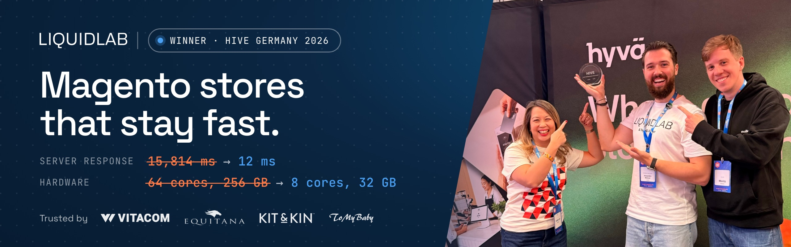

  

  
  
  
  
  

## Hi, I'm Alexandru 👋

Founder & CEO of [LIQUIDLAB](https://liquidlab.ro), a Magento agency from Constanța, Romania. We work only on Magento, because nobody can be an expert in everything, and we chose to go all in on this one. Hyvä is the default frontend on every store we build.

I've been on Magento since 2018: agencies in the UK, the Netherlands and Poland, then lead architect on a platform taking 20,000+ orders a day. What stayed with me: a technical recommendation is only as good as the incentives behind it.

Hyvä partner since 2024, the first in Romania · Romania's first full-service Hyvä agency · Connectif's first Certified Partner in Romania · sponsor of Meet Magento Italy 2026 and Hyvä Developers Paradise 2026.

## 🏆 Best Performance Improvement, HIVE Germany 2026

In October 2026 our [Vitacom.ro](https://vitacom.ro) project won **Best Performance Improvement** at the HIVE Awards in Mainz. Hyvä and Mollie host the awards for projects built on Hyvä, and the room votes the winner live.

The store was already on Hyvä, and still slow. The theme was fine. Underneath it, a single page load ran **15,000,000 database operations**.

| | Before | After |
|---|---:|---:|
| Server response (TTFB) | 15,814 ms | **12 ms** |
| Server | 64 cores, 256 GB RAM | **8 cores, 32 GB RAM** |

Three phases, each one shipped to production and measured before the next began:

1. **Secure.** A new server built for Magento, and the 12 missing security patches installed.
2. **Simplify.** Search rebuilt on ElasticSuite, and an upgrade to Magento 2.4.8.
3. **Accelerate.** Liquid Framework, our Hyvä accelerator, with Hyvä Checkout.

> Hyvä fixes the frontend. If the backend runs millions of database operations per page, no theme will save it.

📄 The full case study, with the before and after tests: **[liquidlab.ro/q/hive](https://liquidlab.ro/q/hive)**

## 🧰 What I work with

  
  
  
  
  
  
  
  
  
  
  
  
  
  
  
  
  

## 📦 Open source

**Mine**

| Module | What it does |
|---|---|
| [module-oauth-security-plus](https://github.com/Hawksama/module-oauth-security-plus) | Only trusted IPs can create Magento 2 admin API tokens (REST and SOAP). |
| [magento-2-performance-optimization](https://github.com/Hawksama/magento-2-performance-optimization) | Google PageSpeed optimisations for Magento 2. |
| [hyva-product-rule-notifier](https://github.com/Hawksama/hyva-product-rule-notifier) | Rule-based notices in the Hyvä minicart and cart, triggered by product attributes. |
| [hyva-used-product-notice](https://github.com/Hawksama/hyva-used-product-notice) and [hyva-checkout-used-product-notice](https://github.com/Hawksama/hyva-checkout-used-product-notice) | A notice for used or no-warranty products on the product page, plus a confirmation step in Hyvä Checkout. |
| [magento2-shopfinder-graphql](https://github.com/Hawksama/magento2-shopfinder-graphql) | GraphQL API and an admin grid for shop locations. |

**At LIQUIDLAB** ([liquidlab-agency](https://github.com/liquidlab-agency))

| Module | What it does |
|---|---|
| [magento2-innoship-hyva-checkout](https://github.com/liquidlab-agency/magento2-innoship-hyva-checkout) | Hyvä Checkout compatibility for InnoShip: a Hyvä-native pickup-point picker with a Leaflet map. |
| [hyva-urgent-cargus](https://github.com/liquidlab-agency/hyva-urgent-cargus) | Cargus Ship & Go pickup points in Hyvä Checkout, on top of [magento2-urgent-cargus](https://github.com/liquidlab-agency/magento2-urgent-cargus), our fork for Magento 2.4 and PHP 8.2/8.3. |
| [hyva-payment-euplatesc](https://github.com/liquidlab-agency/hyva-payment-euplatesc) | euPlatesc payments in Hyvä Checkout. |
| [hyva-mageprince-paymentfee](https://github.com/liquidlab-agency/hyva-mageprince-paymentfee) | Shows the MagePrince payment fee's tax in Hyvä Checkout and exposes it over REST. |
| [magento2-msi-removal](https://github.com/liquidlab-agency/magento2-msi-removal) | Removes MSI and keeps configurable, bundle and grouped products in stock while their children are. |
| [magento2-multiline-grid](https://github.com/liquidlab-agency/magento2-multiline-grid) | Keeps the line breaks of textarea attributes in admin grids. |

## 🤝 Work with us

- **Developers:** LIQUIDLAB is growing after HIVE. If you write Magento or Hyvä and want performance to be the job, not an afterthought, send your CV: [liquidlab.ro/en/jobs](https://liquidlab.ro/en/jobs).
- **Merchants:** a Magento store that got slow? Book a free strategy call: [cal.com/liquidlab](https://cal.com/liquidlab).

Vorbim și în română.
